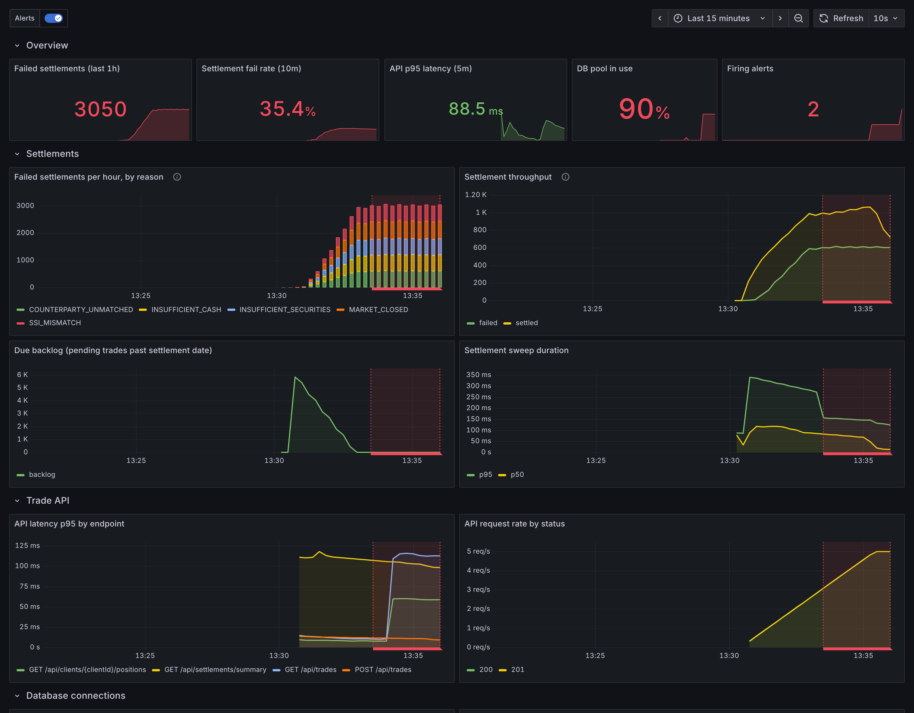
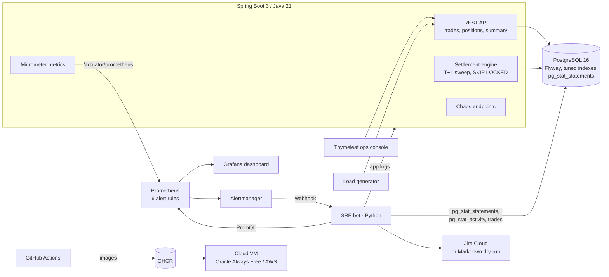

# SettleWatch

**A trade settlement tracker for a custody bank that watches its own health. When something breaks, it works out the likely cause and opens an incident ticket on its own.**

SettleWatch books securities trades, runs them through a T+1 settlement cycle (settled, pending or failed,
with real fail reasons such as SSI mismatches) and reports client positions. Around that core it has the
production tooling a bank runs on: tuned SQL, Prometheus metrics, Grafana dashboards, alerting, and a
Python SRE bot. The bot turns an alert into a diagnosed, ITIL-prioritised Jira ticket.



## Highlights

| | |
|---|---|
| **SQL tuning** | 1M trades. Five hot queries went from **38–52 ms to 0.2–0.9 ms** (48–220x). Under 16 concurrent clients the client-blotter query went from **523 ms to 1.2 ms** average latency, and from 31 to 12,937 queries/s. [Details](docs/performance.md) |
| **Self-diagnosis** | Drop a production index and the bot's latency diagnosis names *that index* as the root cause and gives the fix command. |
| **Incident automation** | Prometheus alert → Alertmanager → Python bot → Jira ticket with probable cause, evidence, sample trades, slow queries, log lines and runbook link. Repeat alerts are de-duplicated, and a resolved alert adds a comment to its ticket. |
| **Fault injection** | Chaos endpoints rehearse three incident types (fail spike, API latency, DB pool exhaustion). The bot recognises drills and marks those tickets `[DRILL]`. |
| **Delivery** | GitHub Actions: Java unit and Testcontainers tests, Python tests, promtool/amtool config validation, multi-arch Docker images to GHCR, one-click SSH deploy (Oracle Cloud free tier or AWS). |

## Architecture



| Layer | Tech |
|---|---|
| Front end | Thymeleaf server-rendered console (dashboard, client positions, trade booking, retry failed trades) |
| Middle tier | Java 21, Spring Boot 3.5, Spring Data JPA, Bean Validation, RFC 7807 errors, virtual threads |
| Back end | PostgreSQL 16, Flyway migrations, partial and composite indexes, `FOR UPDATE SKIP LOCKED` |
| Observability | Micrometer → Prometheus, Grafana (provisioned as code), Alertmanager |
| SRE automation | Python 3.12, Flask, psycopg 3, Jira Cloud REST API v3 (Atlassian Document Format) |
| DevOps | Docker multi-stage multi-arch builds, Docker Compose, GitHub Actions, GHCR, Oracle Cloud / AWS |

## Quick start

Needs Docker with Compose v2.24 or later.

```bash
docker compose up -d --build                     # app, postgres, prometheus, alertmanager, grafana, sre-bot
docker compose --profile seed run --rm seed      # load 1,000,000 mock trades (~25 s)
docker compose --profile load up -d loadgen      # steady trade flow so the dashboards move
```

| URL | What |
|---|---|
| http://localhost:8080 | Ops console |
| http://localhost:3000 | Grafana (dashboard opens on the home page; admin/admin) |
| http://localhost:9090/alerts | Prometheus alert rules |
| http://localhost:8000/tickets | Tickets the SRE bot raised (dry-run mode) |

### Run an incident drill

```bash
curl -XPOST 'localhost:8080/api/admin/chaos/failure-rate?rate=0.5'
# ~2-3 min later: SettlementFailureSpike fires, and the bot opens a P1 ticket
curl localhost:8000/incidents
curl localhost:8000/tickets/OPS-1
curl -XPOST localhost:8080/api/admin/chaos/reset
```

Other drills (latency, pool exhaustion, dropped index) are listed in [docs/runbooks.md](docs/runbooks.md#rehearsing-incidents-game-day).
The bot can also diagnose on demand: `docker compose exec sre-bot python -m sre_bot diagnose HighApiLatency`.

### Real Jira tickets

Create a free Jira Cloud site and an [API token](https://id.atlassian.com/manage-profile/security/api-tokens), then:

```bash
export JIRA_BASE_URL=https://your-site.atlassian.net JIRA_EMAIL=you@example.com \
       JIRA_API_TOKEN=... JIRA_PROJECT_KEY=OPS
docker compose up -d sre-bot
```

Without these variables the bot runs in dry-run mode and writes the same ticket as Markdown.

## Example: ticket raised automatically

From a real drill run, trimmed:

```
[DRILL] [P1] SettlementFailureSpike: Settlement fail rate above 10% over the last 10 minutes

Priority (ITIL): P1 (impact high, urgency high)   Service: settlement-engine
Runbook: docs/runbooks.md#settlementfailurespike

Probable cause
  Fault injection is ACTIVE (failureRateOverride=0.5). This is a drill, not a market event.
  Fails are spread across reasons (top is MARKET_CLOSED at 21%), which points to a systemic
  issue rather than one data problem: settlement engine, CSD connectivity or market-wide disruption.

Evidence
  - 2910 fails vs 4784 successful settlements in the last 30 min (fail rate 37.8%, baseline ~3%).
  - Fails by reason: MARKET_CLOSED=614, COUNTERPARTY_UNMATCHED=579, INSUFFICIENT_CASH=578, ...
  + sample failed trades, recent WARN/ERROR log lines
```

The dropped-index drill produced this diagnosis:

```
Probable cause
  Expected indexes are MISSING: idx_trades_client_status_date. Queries that depended on them
  are now full table scans (see docs/performance.md).
Recommended actions
  1. Recreate them: psql -f src/main/resources/db/migration/V2__performance_indexes.sql
     (use CREATE INDEX CONCURRENTLY on a live system).
```

## API

| Method | Path | Purpose |
|---|---|---|
| `POST` | `/api/trades` | Book a trade (validated ISIN, currency and quantities; T+1 business-day default) |
| `GET` | `/api/trades/{ref}` | Trade by reference |
| `GET` | `/api/trades?clientId=&status=&isin=&page=&size=` | Search (paged) |
| `POST` | `/api/trades/{ref}/settle`, `/fail?reason=`, `/retry` | Manual ops actions (illegal transitions return 409) |
| `GET` | `/api/clients/{clientId}/positions` | Net settled positions |
| `GET` | `/api/settlements/summary` | Counts by status, due backlog, fails by reason (24h) |
| `POST` | `/api/settlements/sweep` | Run a settlement sweep now |
| `GET/POST` | `/api/admin/chaos/...` | Fault injection (`failure-rate`, `latency`, `hog-connections`, `reset`) |
| `GET` | `/actuator/health`, `/actuator/prometheus` | Health and metrics |

## SQL performance

| Query | Before | After | Speed-up |
|---|---:|---:|---:|
| Client blotter (client + status, newest first) | 45.3 ms | 0.22 ms | 210x |
| Settlement engine pickup (due pending trades) | 44.7 ms | 0.93 ms | 48x |
| Failed settlements in last 24h by reason | 50.9 ms | 0.23 ms | 220x |
| Client net positions | 51.6 ms | 0.71 ms | 72x |
| Trades in one security | 37.9 ms | 0.33 ms | 116x |
| **Blotter under 16 concurrent clients (pgbench)** | **523 ms** | **1.2 ms** | **~420x** |

These are measured with `EXPLAIN (ANALYZE, BUFFERS)` on 1M rows. Reproduce them with `perf/benchmark.py` and `perf/load_test.sh`.
The write-up covers why each index has its shape, the partial index that is 160 kB instead of 30 MB, and a
covering index that was **benchmarked and removed** because the planner never used it: [docs/performance.md](docs/performance.md).

## Development

```bash
# Java: needs JDK 21 and Maven; integration tests need Docker (Testcontainers)
mvn verify

# run against a local Postgres
createdb settlewatch && mvn spring-boot:run

# SRE bot
cd sre-bot && pip install -r requirements-dev.txt && pytest
python -m sre_bot serve      # webhook on :8000

# Grafana dashboard is generated, so edit the script, not the JSON
python3 tools/build_dashboard.py
```

Tests: 22 Java tests (domain state machine, service, settlement engine, MVC, full-stack Testcontainers)
and 17 Python tests (diagnosis rules, Jira client, dedupe and resolve flow).

## Deployment

CI ([`.github/workflows/ci.yml`](.github/workflows/ci.yml)) runs on every push and PR. On `main` it also
publishes multi-arch (amd64 + arm64) images `ghcr.io/<owner>/settlewatch` and `settlewatch-sre-bot`.
The **Deploy to server** workflow is manual: it pulls a chosen image tag onto a VM over SSH and
smoke-tests `/actuator/health`. Rolling back means redeploying an older commit SHA.

- **Free forever:** Oracle Cloud Always Free ARM VM, see [docs/deploy-oracle.md](docs/deploy-oracle.md)
- AWS EC2: [docs/deploy-aws.md](docs/deploy-aws.md)

## Repository layout

```
src/main/java/com/settlewatch/   Spring Boot app (domain, repository, service, web)
src/main/resources/db/migration/ Flyway schema + performance indexes
perf/                            1M-row seeder, EXPLAIN ANALYZE benchmark, pgbench load test, results
sre-bot/                         Python alert-to-ticket bot + tests
docker/                          Prometheus rules, Alertmanager, Grafana provisioning
docs/                            performance write-up, runbooks, AWS deployment
.github/workflows/               CI and deploy pipelines
```
